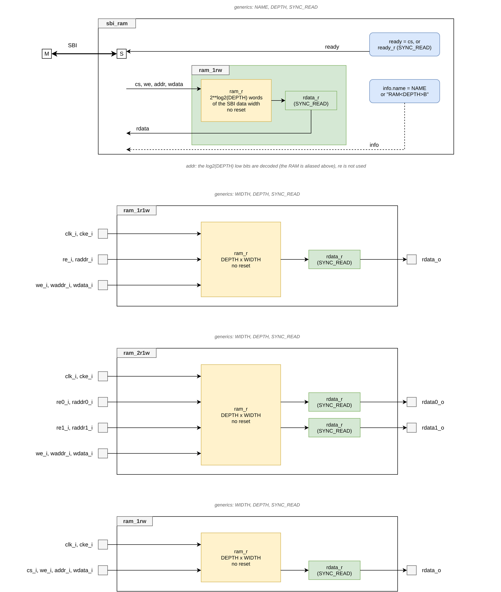
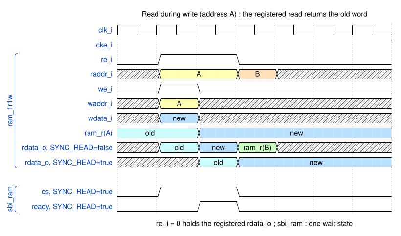

<!--
  README MODEL (common to every Asylum IP, keep the same headings)
  ----------------------------------------------------------------
  Regenerate from the sources, never from the previous README text alone:
    hdl/*.vhd (entities, generics, ports), hdl/csr/*.hjson (register map),
    <IP>.core (VLNV, targets, depends), mk/targets.txt, sim/, syn/, esw/.
  Sections, in this order:
    badges / title + one-line pitch / Overview / Features / Block Diagram /
    Getting Started / Hardware Interfaces / Configuration / Resources /
    Theory of Operation / Registers / Programmer's Guide /
    Design Verification / Dependencies and Related IPs / License
  Rules:
    - English, short and factual: every statement backed by the sources.
    - No VLNV line: the version badge shows it.
    - Badges: first line version, license; second line CI, lint, sim, syn.
    - Block diagram and FSM: pages Overview and FSM of doc/<NAME>.drawio, exported to
      doc/<NAME>-Overview.png and doc/<NAME>-FSM.png (make -C doc).
    - Timing diagrams: WaveDrom source doc/<NAME>-<what>.json, rendered
      doc/<NAME>-<what>.svg (make -C doc), shown as images.
    - No CPU named (OpenBlaze, PicoBlaze, RISC-V) outside the CPU and SoC IPs.
    - Registers: link to the generated hdl/csr/<X>_csr.md, never copy the tables.
    - Tables: Configuration = Name|Type|Default|Description,
      Hardware Interfaces = Name|Direction|Type|Description, grouped by interface.
    - A section with nothing to say is one line ("This IP has no
      software-visible registers."), never removed.
-->
[](https://github.com/deuskane/asylum-component-ram/tags)
[](LICENSE)

[](https://github.com/deuskane/asylum-component-ram/actions/workflows/ci.yml)
[](https://github.com/deuskane/asylum-component-ram/actions/workflows/ci.yml)
[](https://github.com/deuskane/asylum-component-ram/actions/workflows/ci.yml)
[](https://github.com/deuskane/asylum-component-ram/actions/workflows/ci.yml)

# RAM

**Small, readable inferred RAMs in VHDL: one read and one write port, two read ports, single port, asynchronous or registered read, a true dual-port RAM with one clock per port, and a memory on the SBI bus.**

Part of the [Asylum project](https://github.com/deuskane/asylum-project), a collection of small IP cores, written to be read and learned from.

## Table of Contents

1. [Overview](#overview)
2. [Features](#features)
3. [Block Diagram](#block-diagram)
4. [Getting Started](#getting-started)
5. [Hardware Interfaces](#hardware-interfaces)
6. [Configuration](#configuration)
7. [Resources](#resources)
8. [Theory of Operation](#theory-of-operation)
9. [Registers](#registers)
10. [Programmer's Guide](#programmers-guide)
11. [Design Verification](#design-verification)
12. [Dependencies and Related IPs](#dependencies-and-related-ips)
13. [License](#license)

## Overview

This IP gathers the RAMs of Asylum. They are plain VHDL arrays, written so that a synthesis tool infers a memory (distributed RAM or block RAM on an FPGA, flip-flops in an ASIC flow without SRAM macro):

- **`ram_1r1w`**: one read port and one write port (a FIFO storage);
- **`ram_2r1w`**: two read ports and one write port (a register file);
- **`ram_1rw`**: a single port, one address for the read and the write;
- **`sbi_ram`**: `ram_1rw` as a target of the SBI bus (the simple bus of Asylum), a data memory for a CPU;
- **`ram_1r1w_2c`**: one write port and one registered read port, **each with its own clock** (a simple dual-port block RAM), the storage of a dual-clock FIFO;
- **`ram_2rw_2c`**: two read / write ports, **each with its own clock** (a true dual-port block RAM), for two writers on two clocks.

`ram_1r1w`, `ram_2r1w` and `ram_1rw` share the same generics (`WIDTH`, `DEPTH`, `SYNC_READ`) and a clock enable; `ram_1r1w_2c` and `ram_2rw_2c` have `WIDTH`, `DEPTH`, and a clock, a clock enable and a chip select per port.

## Features

- Word width `WIDTH` and number of words `DEPTH` (power of 2), address of `log2(DEPTH)` bits
- `SYNC_READ = false`: combinational read; `SYNC_READ = true`: registered read, enabled by the read enable of the port
- Registered read during a write of the same address: the old word (read-first)
- Synchronous write on the rising edge of `clk_i`, clock enable `cke_i` on every port
- No reset of the memory: block RAM and distributed RAM friendly
- `sbi_ram`: data width of the SBI bus, zero wait state (`SYNC_READ = false`) or one wait state (`SYNC_READ = true`), its name in `sbi_tgt_o.info` (`NAME`, or `RAM<DEPTH>B`)
- `ram_1r1w_2c`: write port on `clk0_i`, registered read port on `clk1_i` (unrelated clocks), one process per clock: the template every synthesis tool infers
- `ram_2rw_2c`: two ports on two unrelated clocks, each one reads (registered, one cycle of latency) or writes one word per cycle of its clock; `rdata` unchanged by a write (no change)
- Simulation check that `DEPTH` is a power of 2

## Block Diagram



## Getting Started

The cores of the Asylum IPs are published in the FuseSoC library [asylum-cores](https://github.com/deuskane/asylum-cores) (with the UVVM core used by the testbench):

```bash
pip install fusesoc
fusesoc library add https://github.com/deuskane/asylum-cores
fusesoc run --target sim_16x8b_sync_read_read_during_write asylum:component:ram  # needs GHDL
```

To use the IP in your design, add `asylum:component:ram` to the `depend` list of your core and instantiate a RAM (library `asylum`, components in `asylum.ram_pkg`):

```vhdl
library asylum;
use     asylum.sbi_pkg.all;
use     asylum.ram_pkg.all;

  -- Data memory of 128 bytes on the SBI bus
  ins_sbi_ram : sbi_ram
    generic map
    ( NAME      => "RAM0"
     ,DEPTH     => 128
     ,SYNC_READ => true
    )
    port map
    ( clk_i     => clk
     ,arst_b_i  => arst_b
     ,sbi_ini_i => sbi_ini           -- 8-bit data, at least 7 address bits
     ,sbi_tgt_o => sbi_tgt
    );

  -- Register file: 16 words of 8 bits, two combinational reads
  ins_regfile : ram_2r1w
    generic map
    ( WIDTH     => 8
     ,DEPTH     => 16
     ,SYNC_READ => false
    )
    port map
    ( clk_i     => clk
     ,cke_i     => '1'
     ,re0_i     => '1'
     ,raddr0_i  => rs1
     ,rdata0_o  => rs1_data
     ,re1_i     => '1'
     ,raddr1_i  => rs2
     ,rdata1_o  => rs2_data
     ,we_i      => rd_we
     ,waddr_i   => rd
     ,wdata_i   => rd_data
    );
```

[PicoSoC](https://github.com/deuskane/asylum-soc-picosoc) is a complete example: its data memories are `sbi_ram` instances.

## Hardware Interfaces

Top-level entity: **`sbi_ram`** ([hdl/sbi_ram.vhd](hdl/sbi_ram.vhd)). The RAMs without bus are below.

### Clock and Reset

| Name | Direction | Type | Description |
|------|-----------|------|-------------|
| `clk_i` | in | std_logic | System clock, the only clock of the IP |
| `arst_b_i` | in | std_logic | Asynchronous reset, active low: only `ready_r` (`SYNC_READ = true`), the memory has no reset |

### Bus (SBI)

| Name | Direction | Type | Description |
|------|-----------|------|-------------|
| `sbi_ini_i` | in | sbi_ini_t | Request from the initiator: `cs`, `we`, `addr` (the `log2(DEPTH)` low bits are used), `wdata`; `re` is not used |
| `sbi_tgt_o` | out | sbi_tgt_t | Response to the initiator: `ready`, `rdata`, `info` |

The word width of `sbi_ram` is the width of the `wdata` field of the SBI signals it is connected to (`SBI_DATA_WIDTH = 8` in `asylum.sbi_pkg`).

### RAMs without bus

[hdl/ram_1r1w.vhd](hdl/ram_1r1w.vhd), [hdl/ram_2r1w.vhd](hdl/ram_2r1w.vhd), [hdl/ram_1rw.vhd](hdl/ram_1rw.vhd), [hdl/ram_2rw_2c.vhd](hdl/ram_2rw_2c.vhd), [hdl/ram_1r1w_2c.vhd](hdl/ram_1r1w_2c.vhd). Every RAM has `clk_i` and `cke_i` (clock enable of the write and of the registered read), `ram_2rw_2c` one `clk<p>_i` and `cke<p>_i` per port `<p>` (0 or 1); the addresses are `std_logic_vector(log2(DEPTH)-1 downto 0)`, the data `std_logic_vector(WIDTH-1 downto 0)`.

| Name | Direction | RAM | Description |
|------|-----------|-----|-------------|
| `re_i`, `raddr_i`, `rdata_o` | in, in, out | `ram_1r1w` | Read port: read enable (`SYNC_READ = true` only), address, data |
| `re0_i`, `raddr0_i`, `rdata0_o` | in, in, out | `ram_2r1w` | Read port 0 |
| `re1_i`, `raddr1_i`, `rdata1_o` | in, in, out | `ram_2r1w` | Read port 1 |
| `we_i`, `waddr_i`, `wdata_i` | in | `ram_1r1w`, `ram_2r1w` | Write port: write enable, address, data |
| `cs_i`, `we_i` | in | `ram_1rw` | Chip select, write enable: write when `cs_i = we_i = 1`, registered read when `cs_i = 1` and `we_i = 0` |
| `addr_i`, `wdata_i`, `rdata_o` | in, in, out | `ram_1rw` | Address of the read and of the write, write data, read data |
| `clk0_i`, `cke0_i`, `we0_i`, `waddr0_i`, `wdata0_i` | in | `ram_1r1w_2c` | Write port: clock, clock enable, write enable, address, data |
| `clk1_i`, `cke1_i`, `re1_i`, `raddr1_i`, `rdata1_o` | in (`rdata1_o` out) | `ram_1r1w_2c` | Read port: clock, clock enable, read enable, address, registered read data |
| `clk0_i`, `cke0_i` | in | `ram_2rw_2c` | Clock and clock enable of port 0 |
| `cs0_i`, `we0_i` | in | `ram_2rw_2c` | Chip select, write enable of port 0: write when `cs0_i = we0_i = 1`, registered read when `cs0_i = 1` and `we0_i = 0` |
| `addr0_i`, `wdata0_i`, `rdata0_o` | in, in, out | `ram_2rw_2c` | Address, write data, registered read data of port 0 |
| `clk1_i`, `cke1_i`, `cs1_i`, `we1_i`, `addr1_i`, `wdata1_i`, `rdata1_o` | in (`rdata1_o` out) | `ram_2rw_2c` | Port 1, the same on its own clock `clk1_i` |

## Configuration

| Name | Type | Default | Description |
|------|------|---------|-------------|
| `WIDTH` | natural | `32` | `ram_1r1w`, `ram_2r1w`, `ram_1rw`, `ram_2rw_2c`, `ram_1r1w_2c`: word width in bits |
| `DEPTH` | natural | `32` (`sbi_ram`: `256`) | Number of words, a power of 2 (simulation assertion of severity `error` otherwise) |
| `SYNC_READ` | boolean | `false` | `false`: combinational read; `true`: registered read (`sbi_ram`: one wait state). Not on `ram_2rw_2c` and `ram_1r1w_2c` (always registered) |
| `NAME` | string | `""` | `sbi_ram` only: name in `sbi_tgt_o.info`; `""` gives `RAM<DEPTH>B` (e.g. `RAM256B`) |

The address has `log2(DEPTH)` bits (rounded down): with a `DEPTH` that is not a power of 2, the words `2**log2(DEPTH)` to `DEPTH-1` cannot be addressed (`sbi_ram` instantiates `2**log2(DEPTH)` words).

## Resources

Figures of the `syn_*` targets (`make nonreg_syn`, see [Targets](#targets)): each RAM synthesized alone with the generics of the configuration, `ram_1r1w`, `ram_2r1w` and `ram_1rw` as toplevel, `sbi_ram` in [syn/sbi_ram_wrapper.vhd](syn/sbi_ram_wrapper.vhd) (flat SBI ports, 8-bit words), by Yosys and its GHDL plugin; the reports are in the build directory of each target.

| Configuration | LUT¹ | LUTRAM¹ | FF¹ | CARRY4¹ | MUXF7/F8¹ | BRAM¹ | DSP¹ | Area² (µm²) | kGE³ |
|---|---|---|---|---|---|---|---|---|---|
| `syn_ram_1r1w_32x32b_read_async` | 1 | 24 | 0 | 0 | 0 | 0 | 0 | 39848.22 | 10.616 |
| `syn_ram_1r1w_256x8b_read_sync` | 13 | 48 | 8 | 0 | 0 | 0 | 0 | 81109.04 | 21.608 |
| `syn_ram_2r1w_32x32b_read_async` | 1 | 48 | 0 | 0 | 0 | 0 | 0 | 47415.48 | 12.632 |
| `syn_ram_2r1w_256x8b_read_sync` | 22 | 96 | 16 | 0 | 0 | 0 | 0 | 96665.21 | 25.753 |
| `syn_ram_1rw_32x32b_read_async` | 1 | 16 | 0 | 0 | 0 | 0 | 0 | 39265.16 | 10.461 |
| `syn_ram_1rw_256x8b_read_sync` | 2 | 32 | 8 | 0 | 0 | 0 | 0 | 79441.19 | 21.164 |
| `syn_sbi_ram_32x8b_read_async` | 1 | 4 | 0 | 0 | 0 | 0 | 0 | 10013.35 | 2.668 |
| `syn_sbi_ram_256x8b_read_sync` | 4 | 32 | 9 | 0 | 0 | 0 | 0 | 79422.42 | 21.159 |
| `syn_ram_1r1w_2c_32x32b` | 2 | 24 | 32 | 0 | 0 | 0 | 0 | 40963.00 | 10.913 |
| `syn_ram_1r1w_2c_256x8b` | 13 | 48 | 8 | 0 | 0 | 0 | 0 | 81109.00 | 21.608 |
| `syn_ram_2rw_2c_32x32b` ⁴ | 4 | 0 | 0 | 0 | 0 | 1 | 0 | — | — |
| `syn_ram_2rw_2c_256x8b` ⁴ | 4 | 0 | 0 | 0 | 0 | 0.5 | 0 | — | — |

¹ Xilinx Artix-7 (LUT6), Yosys 0.33 `synth_xilinx -flatten -noiopad -noclkbuf`, before place and route: every cell of the netlist is counted, Vivado may differ. **Where the memory goes**: in every configuration Yosys puts the memory in distributed RAM (LUTRAM column, 4 LUTs per `RAM32M`, `RAM64M` or `RAM256X1S` cell), none in a block RAM, even 256x8 with a registered read. The registered read data are flip-flops (`WIDTH` per read port: 8 per port in the 256x8 configurations), plus `ready_r` in `sbi_ram` (its `INV` on the reset pin counts as a `LUT1`). `ram_2r1w` uses twice the LUTRAM of `ram_1r1w`: one copy of the memory per read port. Another tool may choose a block RAM for the registered read: check its read-during-write mode (see [Read during write](#read-during-write)).

² SkyWater sky130 `sky130_fd_sc_hd`, typical corner (tt, 25 °C, 1.80 V), Yosys 0.33 `synth` + `dfflibmap` + `abc -liberty`: standard-cell area only, no timing constraint, no buffering, clock tree or placement. **Where the memory goes**: there is no SRAM macro, the memory becomes flip-flops, `DEPTH x WIDTH` of them (256 for 32x8, 1024 for 32x32, 2048 for 256x8), plus the registered read data and the read multiplexers: the area grows mostly with the number of bits, a second read port adds its multiplexer (`ram_2r1w`).

³ Area in thousands of NAND2 gate equivalents (`sky130_fd_sc_hd__nand2_1` = 3.7536 µm²).

⁴ `ram_2rw_2c`: on Artix-7 the memory is one true dual-port block RAM (`RAMB18E1` for 256x8, `RAMB36E1` for 32x32, the BRAM column counts RAMB36 equivalents), its two ports on the two clocks; the 4 LUTs are the `INV` / enables of the ports. In the sky130 flow a memory written on two clocks cannot become flip-flops (a flip-flop has one clock): it needs a dual-port SRAM macro, which the flow does not have, so the memory stays a `$mem_v2` cell of unknown area (no figure; `yosys_synth.py` prints a `WARNING` with the cells of unknown area). The GHDL plugin gives the second write port a priority over the first one, which Yosys 0.33 only accepts between ports of the same clock: the `syn_ram_2rw_2c_*` targets, and only them, need `asylum:utils:yosys_synth` >= 1.1.1 of [asylum-utils-generators](https://github.com/deuskane/asylum-utils-generators), which clears this priority after the GHDL import. `ram_1r1w_2c` (one write port) needs none of this: Yosys maps it as `ram_1r1w` with a registered read (LUTRAM and the read register on Artix-7, flip-flops in sky130).

## Theory of Operation

### Hierarchy

| File | Unit | Role |
|------|------|------|
| [hdl/ram_1r1w.vhd](hdl/ram_1r1w.vhd) | `ram_1r1w` | One read port, one write port |
| [hdl/ram_2r1w.vhd](hdl/ram_2r1w.vhd) | `ram_2r1w` | Two read ports, one write port |
| [hdl/ram_1rw.vhd](hdl/ram_1rw.vhd) | `ram_1rw` | Single port |
| [hdl/ram_2rw_2c.vhd](hdl/ram_2rw_2c.vhd) | `ram_2rw_2c` | Two read / write ports, one clock per port |
| [hdl/ram_1r1w_2c.vhd](hdl/ram_1r1w_2c.vhd) | `ram_1r1w_2c` | One write port, one registered read port, one clock per port |
| [hdl/sbi_ram.vhd](hdl/sbi_ram.vhd) | `sbi_ram` | `ram_1rw` on the SBI bus, ready logic, target name |
| [hdl/ram_pkg.vhd](hdl/ram_pkg.vhd) | `ram_pkg` | Components |

### Write and read



- The memory `ram_r` is an array of `DEPTH` words without reset. A word is written on the rising edge of `clk_i` when `cke_i = 1` and the write is enabled (`we_i`, or `cs_i and we_i` for `ram_1rw`).
- `SYNC_READ = false`: `rdata` is `ram_r(raddr)`, combinational: it follows the address, and a word written on an edge is visible right after it. The read enables are not used.
- `SYNC_READ = true`: `rdata_r` loads `ram_r(raddr)` on the rising edge when `cke_i = 1` and the read enable of the port is 1 (`ram_1rw`: `cs_i = 1` and `we_i = 0`); it keeps its value otherwise, also during a write of `ram_1rw`.
- `ram_2r1w` reads two addresses in the same cycle, each port with its own read enable and read register.

### Read during write

- With `SYNC_READ = true`, a read and a write of the same address on the same enabled edge return the **old** word (read-first): the registered read samples the memory before the write. It is the behaviour of the RTL, checked by the scenario `read_during_write` of the testbench.
- On an FPGA, the contract holds only if the inferred memory keeps it: many dual-port block RAMs are write-first or undefined on a collision. Check the mode chosen by the tool for each RAM that can read and write the same address in the same cycle.
- A design that must not depend on it never reads and writes the same address in the same cycle, or adds its own bypass (`fifo_sync` of [asylum-component-fifo](https://github.com/deuskane/asylum-component-fifo) registers the written word for this case).

### `ram_2rw_2c` (two clocks)

- One process writes `ram_r` on both clocks (a signal written by two processes would be resolved to `'X'`): on the rising edge of `clk0_i`, port 0 writes `wdata0_i` at `addr0_i` when `cke0_i = cs0_i = we0_i = 1`, or loads `ram_r(addr0_i)` into `rdata0_r` when `cke0_i = cs0_i = 1` and `we0_i = 0`; port 1 does the same on `clk1_i`. A write leaves `rdata` unchanged (no change mode of the block RAMs).
- The two clocks may be unrelated: each port only depends on its own clock. The read data of a port change on a rising edge of its clock only (checked by the testbench).
- Simultaneous access of the **same address** by both ports (the user avoids it):
  - write on both ports at the same time: in simulation the write of port 1 wins (last assignment of the process); on a block RAM the word is undefined;
  - read on one port while the other one writes the same word: in simulation the read returns the old word; on a block RAM the read data are undefined (and may be metastable: the path from the RAM to the read register crosses the clock domains), the word written is kept when the writing port does not read (no change mode, as here).
- A read during a write of the other port at another address returns the stored word (scenario `read_during_write`).
- With a single writer, use `ram_1r1w_2c` (below): simpler, and the template every tool infers.

### `ram_1r1w_2c` (two clocks, one writer)

- Two processes: the write process on `clk0_i` writes `wdata0_i` at `waddr0_i` when `cke0_i = we0_i = 1` (the only driver of `ram_r`); the read process on `clk1_i` loads `ram_r(raddr1_i)` into `rdata1_r` when `cke1_i = re1_i = 1`, `rdata1_o` is held otherwise. The simple dual-port template of the synthesis tools (one write clock, one read clock).
- Read of the address written at the same time (collision): the old word in simulation; on a block RAM or a LUTRAM the read data are undefined and may be metastable, the word written is kept. A user that may read a word being written discards the read data (`fifo_async` of [asylum-component-fifo](https://github.com/deuskane/asylum-component-fifo): while the FIFO is empty it reads the address of the next write, with `m_axis_tvalid_o = 0`, and reads it again once the write is seen through its synchronizers).
- Timing: the path from the RAM (written on `clk0_i`) to `rdata1_r` (on `clk1_i`) crosses the clock domains: declare it as a false path, or as max delay of one `clk1_i` period, as the user's protocol allows (in `fifo_async`, a word is read at least one read clock period after its write).

### `sbi_ram`

- `sbi_ini_i.cs`, `we`, `addr(log2(DEPTH)-1 downto 0)` and `wdata` drive `ram_1rw` (`cke_i = 1`), its read data is `sbi_tgt_o.rdata`.
- Only the `log2(DEPTH)` low address bits are decoded: the RAM is repeated above (the interconnect decodes the base address).
- `SYNC_READ = false`: `ready = cs`, every access takes one cycle.
- `SYNC_READ = true`: `ready_r <= cs and not ready_r`: `ready` rises one cycle after `cs` (the read data are registered) and falls the next cycle, every access takes two cycles. A write held two cycles writes the same word twice.
- `sbi_tgt_o.info.name` is `NAME`, or `RAM<DEPTH>B` when `NAME = ""`.

## Registers

This IP has no software-visible registers: every SBI address of `sbi_ram` below `2**log2(DEPTH)` is a word of the memory.

## Programmer's Guide

`sbi_ram` has no registers: software reads and writes its words as plain memory (one byte per address with the 8-bit SBI bus); the memory is not initialized, write a word before reading it.

## Design Verification

### Testbench

| File | DUT | Description |
|------|-----|-------------|
| [sim/ram/tb_ram.vhd](sim/ram/tb_ram.vhd) | `ram_1r1w`, `ram_2r1w`, `ram_1rw`, `sbi_ram` | Self-checking UVVM testbench, generics `TESTS_LIST` (scenarios, see below), `WIDTH`, `DEPTH` (power of 2, >= 16), `SYNC_READ`. The three RAMs without bus receive the same accesses (`ram_1rw`: `cs = we or re0`, address = write address during a write, else read address 0) and share one reference model: every cycle the inputs are driven on the falling edge of the clock and the read data of every port are checked a quarter period later, against the content (combinational read) or the word registered by the last enabled read. `sbi_ram` is driven by the SBI BFM (`bitvis_vip_sbi`); a monitor measures the wait states of every access and raises an error if `ready` is set without `cs`. A second `sbi_ram` with `NAME = "RAM0"` is only used for its name |

| [sim/ram_2rw_2c/tb_ram_2rw_2c.vhd](sim/ram_2rw_2c/tb_ram_2rw_2c.vhd) | `ram_2rw_2c` | Self-checking UVVM testbench, generics `TESTS_LIST`, `WIDTH`, `DEPTH` (power of 2, >= 2), `CLK0_PERIOD` and `CLK1_PERIOD` (ns, the clocks of the two ports). Each port is driven on the falling edges of its own clock (one access, then idle) and its read data checked on the next falling edge; the `concurrent` and `read_during_write` scenarios drive both ports at the same time, each on its own edges. A monitor checks that the read data of a port change on a rising edge of its own clock only |

| [sim/ram_1r1w_2c/tb_ram_1r1w_2c.vhd](sim/ram_1r1w_2c/tb_ram_1r1w_2c.vhd) | `ram_1r1w_2c` | Self-checking UVVM testbench, generics `TESTS_LIST`, `WIDTH`, `DEPTH` (power of 2, >= 2), `CLK0_PERIOD`, `CLK1_PERIOD` (ns): the port helpers of `tb_ram_2rw_2c_bfm_pkg` (port 0 drives the write port, port 1 the read port), a monitor of `rdata1_o` (changes on a rising edge of `clk1` only) |

Scenarios in `tb_ram_<name>_pkg`, cycle, model and SBI helpers in [tb_ram_bfm_pkg](sim/ram/tb_ram_bfm_pkg.vhd), names and dispatch in [tb_ram_tests_pkg](sim/ram/tb_ram_tests_pkg.vhd); for `ram_2rw_2c`, in `tb_ram_2rw_2c_<name>_pkg`, [tb_ram_2rw_2c_bfm_pkg](sim/ram_2rw_2c/tb_ram_2rw_2c_bfm_pkg.vhd) and [tb_ram_2rw_2c_tests_pkg](sim/ram_2rw_2c/tb_ram_2rw_2c_tests_pkg.vhd).

### Scenarios (`TESTS_LIST`)

The scenarios are chosen at run time with the generic `TESTS_LIST`: names separated by `,` without space (`write_read,random,write_read`), a name may be repeated. The sequencer first checks every name (an unknown name is a `TB_ERROR` before any scenario runs), then for each scenario drives a reset pulse with the RAM inputs and the bus inactive, empties the reference model, logs `TEST <i>/<N> : <name>` and runs it. The memories are not reset: each scenario writes the words it reads (the model checks a word only once written by the scenario). The empty list (default) only compiles and elaborates the testbench. The list is parsed and its names checked with `list_length` / `list_item` / `list_contains` of `asylum.string_pkg` (`asylum:utils:pkg` >= 1.10.0).

Checks counted as the `=> OK` lines of the log, reference configuration (16 words of 8 bits, `SYNC_READ = true`):

| Name | Checks | Description |
|------|--------|-------------|
| `write_read` | 68 | Write of every word, then read of every word (`ram_2r1w` port 1 in reverse order); the idle cycles hold the registered read data |
| `read_during_write` | 127 | Read and write of the same address on the same edge: the registered read returns the old word, the next read the new word |
| `clock_enable` | 20 | `cke_i = 0` blocks the writes and the registered reads of every port |
| `read_enable` | 16 | A read enable at 0 holds the registered read data while the address changes; a write of `ram_1rw` does not update its registered read data |
| `write_enable` | 124 | A write not selected (`we_i = 0` on `ram_1r1w` / `ram_2r1w`, `cs_i = 0` with `we_i = 1` on `ram_1rw`) does not change the word |
| `random` | 3999 | 1000 random cycles: reads (60 %), writes (50 %), `cke_i = 1` (90 %), random addresses and data, fixed seeds |
| `sbi_write_read` | 80 | `sbi_ram`: write then read of every word, then back-to-back write and read of each word; wait states of every access (0, or 1 with `SYNC_READ`) |
| `sbi_aliasing` | 9 | `sbi_ram`: the word written at `DEPTH+3` is read at 3, `DEPTH+3`, `2*DEPTH+3` and `3*DEPTH+3`; wait states |
| `sbi_name` | 2 | `sbi_tgt_o.info.name`: `RAM<DEPTH>B` with `NAME = ""`, `NAME` otherwise |

With `SYNC_READ = false` the read data are checked on every cycle (no registered data to wait for): more checks, e.g. 4769 in `sim_16x8b_async_read`.

`tb_ram_2rw_2c`, reference configuration (16 words of 8 bits, `clk0` 10 ns, `clk1` 13 ns), same sequencer (no reset: both ports idle for a few cycles before each scenario, each scenario writes the words it reads):

| Name | Checks | Description |
|------|--------|-------------|
| `port0` | 16 | Port 0 alone (port 1 idle): every address written, then read back |
| `port1` | 16 | Port 1 alone (port 0 idle): every address written, then read back |
| `cross` | 32 | Every address written by one port and read back by the other one (other clock), in both directions |
| `concurrent` | 16 | Both ports busy at the same time on their own clocks: port 0 writes the even addresses while port 1 writes the odd ones, then each port reads the words of the other one |
| `read_during_write` | 64 | One port reads the same address on every cycle while the other one writes every other address: the read word stays the old one; then the new words are read back. Port 1 reads while port 0 writes, then the reverse |
| `enables` | 18 | On each port: `cke = 0` or `cs = 0` blocks the write and the read (`rdata` held), a write keeps `rdata` (no change) |

`tb_ram_1r1w_2c`, reference configuration (16 words of 8 bits, write clock 10 ns, read clock 13 ns):

| Name | Checks | Description |
|------|--------|-------------|
| `write_read` | 32 | Every address written on `clk0`, read back on `clk1`, two patterns |
| `concurrent` | 16 | Both ports busy at the same time: one word written per `clk0` cycle, one word read per `clk1` cycle, each word read after its write |
| `read_during_write` | 28 | The read port reads the same address on every cycle while the write port writes every other address (old word), then the new words read back |
| `enables` | 5 | `cke0 = 0` or `we0 = 0` blocks the write; `cke1 = 0` or `re1 = 0` holds `rdata1_o` |

The two-clock testbenches were checked with RTL mutants (scratch copies), each scenario of the reference configuration run alone: `ram_2rw_2c` 11 (a write of either port ignored, write-first, `cke1` or `cs0` ignored, address or read data of the other port, port 1 on `clk0`, read during the port's own write, address bit dropped, extra write), `ram_1r1w_2c` 7 (`we0` or `cke0` ignored, `re1` or `cke1` ignored, read port on `clk0`, write port on `clk1`, read at the write address): every mutant is killed (the read port on the wrong clock by the monitor of the read data).

### Targets

| Target | Toplevel | Description |
|--------|----------|-------------|
| `default` | `ram_1r1w` | HDL fileset (not a simulation) |
| `sim_16x8b_sync_read` | `tb_ram` | Reference configuration (`WIDTH = 8`, `DEPTH = 16`, `SYNC_READ = true`): build and elaboration only (`TESTS_LIST` empty), base of the scenario targets and of the list runs |
| `sim_16x8b_sync_read_<name>` | `tb_ram` | One target per scenario: `sim_16x8b_sync_read_write_read`, `_read_during_write`, `_clock_enable`, `_read_enable`, `_write_enable`, `_random`, `_sbi_write_read`, `_sbi_aliasing`, `_sbi_name` (4445 checks in all) |
| `sim_16x8b_async_read` | `tb_ram` | `WIDTH = 8`, `DEPTH = 16`, `SYNC_READ = false`, every scenario (4769 checks) |
| `sim_64x32b_sync_read` | `tb_ram` | `WIDTH = 32`, `DEPTH = 64`, `SYNC_READ = true`, every scenario (5645 checks) |
| `sim_64x32b_async_read` | `tb_ram` | `WIDTH = 32`, `DEPTH = 64`, `SYNC_READ = false`, every scenario (6833 checks) |
| `sim_2rw_2c_16x8b` | `tb_ram_2rw_2c` | `ram_2rw_2c` reference configuration (`WIDTH = 8`, `DEPTH = 16`, `CLK0_PERIOD = 10`, `CLK1_PERIOD = 13`): build and elaboration only |
| `sim_2rw_2c_16x8b_<name>` | `tb_ram_2rw_2c` | One target per scenario: `_port0`, `_port1`, `_cross`, `_concurrent`, `_read_during_write`, `_enables` (162 checks in all) |
| `sim_2rw_2c_64x32b_port0_fast` | `tb_ram_2rw_2c` | `WIDTH = 32`, `DEPTH = 64`, `clk0` 7 ns, `clk1` 23 ns, every scenario (695 checks) |
| `sim_2rw_2c_16x8b_port1_fast` | `tb_ram_2rw_2c` | `WIDTH = 8`, `DEPTH = 16`, `clk0` 23 ns, `clk1` 7 ns, every scenario (182 checks) |
| `sim_2rw_2c_2x8b_same_clock` | `tb_ram_2rw_2c` | `WIDTH = 8`, `DEPTH = 2`, both clocks of 10 ns with their edges together, every scenario (35 checks) |
| `sim_1r1w_2c_16x8b` | `tb_ram_1r1w_2c` | `ram_1r1w_2c` reference configuration (`WIDTH = 8`, `DEPTH = 16`, clocks 10 / 13 ns): build and elaboration only |
| `sim_1r1w_2c_16x8b_<name>` | `tb_ram_1r1w_2c` | One target per scenario: `_write_read`, `_concurrent`, `_read_during_write`, `_enables` (81 checks in all) |
| `sim_1r1w_2c_64x32b_write_fast` | `tb_ram_1r1w_2c` | `WIDTH = 32`, `DEPTH = 64`, write clock 7 ns, read clock 23 ns, every scenario (281 checks) |
| `sim_1r1w_2c_16x8b_read_fast` | `tb_ram_1r1w_2c` | `WIDTH = 8`, `DEPTH = 16`, write clock 23 ns, read clock 7 ns, every scenario (122 checks) |
| `sim_1r1w_2c_2x8b_same_clock` | `tb_ram_1r1w_2c` | `WIDTH = 8`, `DEPTH = 2`, both clocks of 10 ns with their edges together, every scenario (15 checks) |
| `lint_ghdl` | `asylum.sbi_ram_wrapper` | GHDL `-Wall` analysis of every RAM and of [syn/sbi_ram_wrapper.vhd](syn/sbi_ram_wrapper.vhd) (`sbi_ram` with flat SBI ports), elaboration of `sbi_ram_wrapper` |
| `lint_ghdl_synth_<ram>_<config>` | the RAM, or `sbi_ram_wrapper` | `ghdl --synth` check (no latch, synthesizable) of `ram_1r1w`, `ram_2r1w`, `ram_1rw`: `32x32b_read_async` (default generics), `256x8b_read_sync`; of `ram_2rw_2c` and `ram_1r1w_2c`: `32x32b` (default generics), `256x8b`; of `sbi_ram`: `32x8b_read_async`, `256x8b_read_sync` |

The reference configuration has a build-only base target and one target per scenario: one CI job per scenario, a failure is isolated. Every other configuration has one target that runs the whole list: the `TEST <i>/<N>` header names a failing scenario. FuseSoC replaces the `parameters` list of an inherited target, so each target repeats the generics of its configuration.

Every `sim_*`, `lint_*` and `syn_*` target is a job of the [GitHub CI](https://github.com/deuskane/asylum-component-ram/actions/workflows/ci.yml), run in the [asylum-env](https://github.com/deuskane/asylum-ci) image (GHDL, FuseSoC, UVVM, Yosys). The `sim`, `lint` and `syn` badges count the passed and failed targets of the last run on `main`.

### How to Run

From a clone of [asylum-project](https://github.com/deuskane/asylum-project) (GHDL and FuseSoC installed, or in the asylum-env image):

```bash
make help                                    # variables, rules and targets
make sim_16x8b_sync_read_read_during_write   # one scenario, log in log/
make sim_64x32b_async_read                   # every scenario of a configuration
make nonreg_sim                              # every sim_* target
make nonreg_lint                             # every lint_* target
make nonreg_syn                              # every syn_* target (Yosys, figures of Resources)
make TARGETS_FILTER=sbi_ram nonreg_syn
```

To run a list of scenarios, build the testbench once, then run the list without recompiling, either with FuseSoC (same `--build-root` and `--no-export` as the Makefile, so that the build of the target is reused; any generic of the target can be overridden after the VLNV):

```bash
make sim_16x8b_sync_read                     # build and elaboration (TESTS_LIST empty)
fusesoc --cores-root . run --build-root build --no-export --run --target sim_16x8b_sync_read asylum:component:ram:1.3.0 --TESTS_LIST=random,write_read
```

or in the build directory of the target. `EXTRA_OPTIONS` replaces every generic set by the target: repeat the generics of the configuration, else their default values apply:

```bash
cd build/asylum_component_ram_1.3.0/sim_16x8b_sync_read-ghdl
make run EXTRA_OPTIONS="-gTESTS_LIST=random,write_read -gWIDTH=8 -gDEPTH=16 -gSYNC_READ=true"
```

To add a scenario (`tb_ram`; the same with `tb_ram_2rw_2c_*`, `files_sim_2rw_2c` and `sim_2rw_2c_16x8b_<name>` for `ram_2rw_2c`): a `tb_ram_<name>_pkg` package with a `run` procedure in the `files_sim` fileset, its name in `C_TESTS` and its case in `run_test` of [tb_ram_tests_pkg](sim/ram/tb_ram_tests_pkg.vhd), a `sim_16x8b_sync_read_<name>` target and the name in the `TESTS_LIST` of the other configurations in [ram.core](ram.core), then `make mk/targets.txt` and `make ci_generate`.

Outside the CI, GHDL writes a waveform `dut.fst`.

## Dependencies and Related IPs

| Core | Repository | Purpose |
|------|------------|---------|
| `asylum:utils:pkg` | [asylum-utils-pkg](https://github.com/deuskane/asylum-utils-pkg) | `math_pkg` (`log2`), `sbi_pkg` (SBI records, `to_sbi_name`); the testbench needs >= 1.10.0 (`string_pkg` lists of `TESTS_LIST`) |
| `asylum:utils:ghdl_synth` | [asylum-utils-generators](https://github.com/deuskane/asylum-utils-generators) | `ghdl --synth` check of the `lint_ghdl_synth_*` targets |
| `asylum:utils:yosys_synth` | [asylum-utils-generators](https://github.com/deuskane/asylum-utils-generators) | Yosys synthesis of the `syn_*` targets (Artix-7 and sky130); >= 1.1.1 for `syn_ram_2rw_2c_*` (a memory written on two clocks) |
| `bitvis:verification:uvvm` | [UVVM](https://github.com/UVVM/UVVM) | Verification library and SBI BFM |

The synthesis checks use the dependency-free cores `ghdl_synth` and `yosys_synth`, not `asylum:utils:generators`: the generators depend on the FIFO, which depends on this IP.

Used by [asylum-component-fifo](https://github.com/deuskane/asylum-component-fifo) (`ram_1r1w` in `fifo_sync`, `ram_1r1w_2c` in `fifo_async`) and [asylum-component-stack](https://github.com/deuskane/asylum-component-stack) (`ram_1r1w`), and [asylum-soc-picosoc](https://github.com/deuskane/asylum-soc-picosoc) (`sbi_ram`); the register banks generated by regtool use it through the FIFO. All the IPs: [asylum-project](https://github.com/deuskane/asylum-project).

## License

Apache License 2.0, see [LICENSE](LICENSE).
